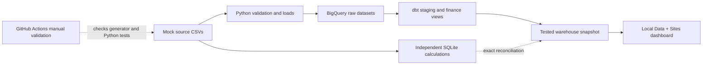

# Miniature SaaS Finance Data Platform

**[Read the portfolio case study →](docs/case_study.md)**
A visual walkthrough of the business problem, architecture, dashboard screenshots,
validation evidence and lessons learned. All financial data is synthetic.

**[Open the interactive project guide](https://saas-finance-project-guide.jmperry41.chatgpt.site)**
(private; sign in with the owner ChatGPT account). Explore the overview, all seven
milestones, API practice, data flow, metric definitions, validation and downloads.
The guide's [HTML/CSS/JavaScript source](project-guide/) is also available here.

Download the current one-page data-flow infographic:
[PDF](output/pdf/saas_finance_data_flow.pdf) · [PNG image](output/pdf/saas_finance_data_flow.png).

**Verified October 28, 2026:** one manual command now validates and refreshes
all 14 BigQuery raw tables, builds/tests dbt, reconciles 4,047 dashboard rows,
and rebuilds the local Data + Sites dashboard from actual warehouse results.
The first complete run passed; billing remained disabled. Read the
[manual refresh lesson](docs/manual_refresh.md).

A hands-on learning project for Jack: connect familiar FP&A concepts to Python,
relational data, BigQuery, dbt, automation, and financial dashboards. All company
and person records are fictional; there are no live vendor integrations.

The foundation includes 14 synthetic source tables, SQLite SQL exercises,
BigQuery raw data, Pandas GL ingestion, a paginated mock customer API, 14 dbt
models, a successful hosted GitHub validation run, and a Data + Sites dashboard.
The current local suite passes 73 Python tests; dashboard calculations pass 186
comparisons plus coverage/plan assertions. [GitHub validation](https://github.com/jmperry15-hash/saas-finance-data-platform-codex/actions/runs/40796000119)
passed on application commit `614edb6`, including the dashboard checks.

This portfolio update adds reproducible dashboard checks to the manual GitHub
workflow. Follow [the fresh-clone lesson](docs/portfolio_validation.md). The main
remaining step is [the user metric walkthrough](docs/final_walkthrough.md).
The private hosted dashboard was updated and verified on October 29. A schedule is optional. See the
[current project status](docs/project_status.md) for boundaries and evidence.

## Current architecture




The local dashboard uses the saved warehouse export from the manual pipeline.
The private hosted website was updated October 29 with the same verified export.
Its data extraction timestamp remains October 28; browsing does not query BigQuery.

Python extracts and loads source data; dbt applies business transformations in
the warehouse. That is **ELT**: extract, load, then transform. Small Python cleanup
steps before loading are still useful. We will learn joins and relational
constraints in SQLite before comparing them with an analytical warehouse.

| Layer | Tool | Why it belongs here | When |
| --- | --- | --- | --- |
| Local code and version history | Python, virtual environment, Git | Reproducible code and a safe place to experiment | Now |
| Source data | Python standard library and CSV | Readable exports with no packages or accounts required | Now |
| Relational SQL practice | SQLite via Python `sqlite3` | Primary/foreign keys, joins, aggregation, constraints | Milestone 2 |
| Warehouse | Google BigQuery Sandbox | Columnar analytical storage, datasets, query costs | Milestone 3 |
| Ingestion | Pandas, Google BigQuery Python client | Explicit schemas, batch loads, logging, retries | Milestone 4 |
| API practice | Local mock HTTP API | Pagination, request errors, extraction without paid vendor access | Milestone 4 |
| Transformation | dbt Core and `dbt-bigquery` | SQL models, dependency graph, tests, documentation | Milestone 5 |
| Automation | GitHub Actions, standard Linux runners | Repeat validated local commands remotely | Milestone 6 |
| Reporting | Data + Sites | Finance dashboard with drilldowns and reconciled measures | Implemented; manual warehouse refresh passes |

See [architecture and cost safeguards](docs/architecture.md) for dataset design,
metric definitions, refresh design, security, and free-tier limits.

Download the [three-page data lineage PDF](output/pdf/saas_finance_lineage.pdf)
or [high-resolution lineage image](output/pdf/saas_finance_lineage.png).
These preserve the pre-publication lineage snapshot: implemented Python paths,
all 14 raw tables, all 14 dbt models,
SQL reporting queries, and planned components as of October 26. The diagram
builder in `scripts/build_lineage_diagram.py` checks its 22 direct model edges
against the actual SQL; it requires ReportLab only for document generation.

## Milestones and acceptance gates

Finish and understand each gate before starting the next milestone.

| Milestone | What we implement | You practice | Gate |
| --- | --- | --- | --- |
| **1. Synthetic sources — complete** | Shared IDs, customer contracts, workforce, GL, budgets/forecasts; validation | Read a Python function, change a seed, trace a record | Reproducible exports, balanced journals, cross-system reconciliations and fault tests pass |
| **2. Relational SQL — lab ready** | CSVs loaded into local SQLite; eight SQL lessons | `SELECT`, `JOIN`, `GROUP BY`, keys, grain, window functions | Technical checks pass; complete the guided practice before moving on |
| **3. BigQuery Sandbox — uploads and GL verified** | All 14 raw tables loaded; user confirmed GL SQL totals | Datasets, schemas, warehouse vs operational DB, dry runs | Row counts and GL pass; query-cost review and detailed finance checks remain |
| **4. Python ingestion and API practice — core exercises verified** | Pandas and GL refresh/rerun; six-page customer extraction | Types, API responses, retries, idempotency, logging | Success path verified; manual failure practice skipped; API-to-warehouse integration deferred |
| **5. dbt Core — core reporting built** | Staging views, P&L, BUD2025, ARR/customers, bookings and workforce | `ref`, `source`, grain, joins, window functions and tests | Lesson builds and reconciliations pass; optional retention and additional plan models deferred |
| **6. GitHub Actions — hosted validation passed** | Offline CI and complete manual refresh verified; schedule optional | YAML, permissions, logs, short-lived authentication | Deliberately bad input fails CI; good manual refresh succeeds within free allowances |
| **7. Dashboard — Data + Sites implemented** | P&L/BvA, ARR/bookings/customers, workforce, spending, variance drivers | Filters, chart design, metric definitions and source reconciliation | Warehouse-backed local refresh and private hosted update verified |

The current exercise is [one manual refresh](docs/manual_refresh.md):
load all sources, build/test dbt, reconcile and export the local dashboard.
Read the [project status](docs/project_status.md) for completed work, evidence
and remaining scope. Earlier cloud uploads and Python refreshes are evidenced
by user screenshots/SQL confirmations and prior live read-only checks.

## Folder structure

```text
saas-finance-data-platform/
├── README.md
├── .gitignore
├── config/scenario.json           # Small, editable synthetic scenario
├── src/synthetic/
│   ├── schema.py                  # Tables, columns, keys, accounts, departments
│   ├── generate.py                # Source generation and journal posting
│   └── validate.py                # Read and reconcile saved CSVs
├── src/database/                 # SQLite loader and read-only query runner
├── sql/
│   ├── schema.sql                # CREATE TABLE definitions and constraints
│   └── lessons/                  # Eight commented SQL examples
├── tests/test_synthetic.py        # Reproducibility and deliberate failure tests
├── tests/test_database.py         # Database constraints and finance SQL tests
├── docs/
│   ├── architecture.md
│   ├── data_dictionary.md
│   ├── milestone_01.md            # Source data walkthrough
│   └── milestone_02.md            # Guided SQL practice
├── data/local/                    # SQLite database; ignored by Git
├── data/generated/               # Local only; ignored by Git
│   ├── shared/
│   ├── netsuite/
│   ├── salesforce/
│   ├── workday/
│   ├── pigment/
│   ├── manifest.json             # Settings, row counts, SHA-256 file fingerprints
│   └── validation_report.json    # Controls from the saved-file validation
└── .venv/                        # Local Python environment; ignored by Git
```

The later lessons have added `src/ingestion/`, `scripts/`, `config/dbt/`, and
`dbt/` with 14 staging/reporting models and their tests. `requirements-ingestion.txt`
and `requirements-dbt.txt` describe the separate environments.
`.github/workflows/validate.yml` contains the manual validation workflow.
`docs/milestone_06.md` explains automation; `docs/project_status.md` tracks remaining
work. `dashboard-site/` implements the reporting UI; `sql/dashboard/` contains
warehouse reconciliation queries and `scripts/reconcile_dashboard.py` compares
them with the saved snapshot.

## Run milestone 1

The environment and initial dataset are already created on this machine. From
the repository folder:

```bash
source .venv/bin/activate
python -m src.synthetic.validate
python -m unittest discover -s tests -p test_synthetic.py -v
```

For a fresh clone, first run `python3 -m venv .venv`, activate it, then run:

```bash
python -m src.synthetic.generate
```

Python 3.9+ runs this dependency-free milestone. The installed system Python is
3.9.6; use a maintained Python version in a new environment before installing
cloud/dbt/Streamlit dependencies later. No packages need installing now.

The generator refuses to overwrite a nonempty output directory. For another run:

```bash
python -m src.synthetic.generate --output data/generated/practice_run
python -m src.synthetic.validate --input data/generated/practice_run
```

Choose a new output subdirectory for each experiment. `data/generated/` is
ignored recursively. Default seed 42 reproduces identical source files under
the same Python runtime and code. Hashes help compare runs; validation rechecks
the actual CSV contents rather than trusting an old report.

## Run milestone 2

The local database has already been built and verified. Start with:

```bash
source .venv/bin/activate
python -m src.database.query --file sql/lessons/01_select.sql
```

Follow [the SQL walkthrough](docs/milestone_02.md) one lesson at a time. It
explains the statements, gives expected results and small exercises, and shows
how to load a new database after cloning. No package installation is required.
The complete Python suite now includes 73 tests, covering source controls,
ingestion, API extraction, reconciliation and refresh failure handling. Run the full suite with
`.venv-ingestion/bin/python -m unittest discover -s tests`; the original `.venv`
has no Pandas. Offline checks do not establish successful cloud uploads.

## GitHub repository and first workflow run

The project is published as a **public portfolio**, as explicitly chosen by Jack:
[saas-finance-data-platform-codex](https://github.com/jmperry15-hash/saas-finance-data-platform-codex).
Local `main` tracks `origin/main`. Source code, documentation and lineage diagrams
are included; generated data, Python environments and local credentials are ignored.
The full history was checked for common credential patterns before the first push;
that check is not a guarantee against every possible secret format.

The first hosted validation run passed on commit `618ae46`. The expanded
workflow also [passed on `614edb6`](https://github.com/jmperry15-hash/saas-finance-data-platform-codex/actions/runs/40796000119)
on October 28, including fresh dependency installation and dashboard checks.
Open [Actions](https://github.com/jmperry15-hash/saas-finance-data-platform-codex/actions/workflows/validate.yml), choose **Run workflow**, select
**main**, then click the green **Run workflow** button. Use your signed-in browser.
It generates synthetic data, validates it, runs the Python suite and verifies
the dashboard finance model against independent SQL totals. It does not
refresh BigQuery. Pushing alone does not start this manually triggered workflow.

The workflow uses a standard Ubuntu runner, with no artifact uploads or cache.
Standard hosted runners are free for public repositories under
[GitHub's current billing rules](https://docs.github.com/en/billing/concepts/product-billing/github-actions).
Recheck allowances and block paid overages if the repository becomes private.

Continue with [milestone 6: automation](docs/milestone_06.md).
