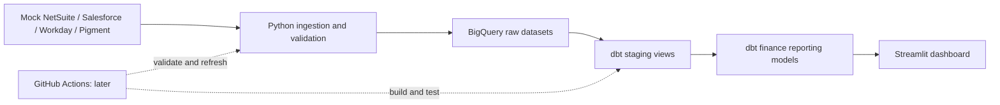

# Miniature SaaS Finance Data Platform

**Current cloud status, October 24, 2026:** you disabled billing for
`saas-finance-learning-512616`; the screenshot and subsequent uploader run show
the billing gate passed. Continue without a billing override. The helper now
reuses the existing raw dataset location instead of requiring US; see the
[updated continuation command](docs/bigquery_bulk_upload.md).

A hands-on learning project for Jack: connect familiar FP&A concepts to Python,
relational data, BigQuery, dbt, automation, and Streamlit.

**Status: first dbt view built and all five data tests passed (October 26).**
The user's Cloud Shell output confirms all 14 tables loaded in `us-south1`, with
matching schemas and row counts. The user also confirmed 16,648 GL lines and
$77,741,040.10 per side, with zero difference, through BigQuery SQL.
Query-cost review and detailed cloud revenue/payroll reconciliation remain open.
The [Pandas exercise and single-table Python loader](docs/milestone_04.md) are implemented.
The user's two Python refresh outputs confirm unchanged row counts and GL totals.
The [local mock API and extractor](docs/api_exercise.md) are implemented and tested;
the user's successful six-page extraction is verified. Manual failure practice was
skipped at the user's request. The [first dbt department view](docs/milestone_05.md)
is built and tested. API-to-warehouse loading, all-source refresh, financial dbt
models, Actions, and dashboard remain planned.
All company and person records are fictional. There are no live source-system integrations.

## Proposed architecture



Python extracts and loads source data; dbt applies business transformations in
the warehouse. That is **ELT**: extract, load, then transform. Small Python cleanup
steps before loading are still useful. We will learn joins and relational
constraints in SQLite before comparing them with an analytical warehouse.

| Layer | Tool | Why it belongs here | When |
| --- | --- | --- | --- |
| Local code and version history | Python, virtual environment, Git | Reproducible code and a safe place to experiment | Now |
| Source data | Python standard library and CSV | Readable exports with no packages or accounts required | Now |
| Relational SQL practice | SQLite via Python `sqlite3` | Primary/foreign keys, joins, aggregation, constraints | Milestone 2 |
| Warehouse | Google BigQuery Sandbox | Columnar analytical storage, datasets, query costs | Milestone 3 |
| Ingestion | Pandas, Google BigQuery Python client | Explicit schemas, batch loads, logging, retries | Milestone 4 |
| API practice | Local mock HTTP API | Pagination, request errors, extraction without paid vendor access | Milestone 4 |
| Transformation | dbt Core and `dbt-bigquery` | SQL models, dependency graph, tests, documentation | Milestone 5 |
| Automation | GitHub Actions, standard Linux runners | Repeat validated local commands remotely | Milestone 6 |
| Reporting | Streamlit, Pandas, charts | Finance dashboard with drilldowns and reconciled measures | Milestone 7 |

See [architecture and cost safeguards](docs/architecture.md) for dataset design,
metric definitions, refresh design, security, and free-tier limits.

## Milestones and acceptance gates

Finish and understand each gate before starting the next milestone.

| Milestone | What we implement | You practice | Gate |
| --- | --- | --- | --- |
| **1. Synthetic sources — complete** | Shared IDs, customer contracts, workforce, GL, budgets/forecasts; validation | Read a Python function, change a seed, trace a record | Reproducible exports, balanced journals, cross-system reconciliations and fault tests pass |
| **2. Relational SQL — lab ready** | CSVs loaded into local SQLite; eight SQL lessons | `SELECT`, `JOIN`, `GROUP BY`, keys, grain, window functions | Technical checks pass; complete the guided practice before moving on |
| **3. BigQuery Sandbox — uploads and GL verified** | All 14 raw tables loaded; user confirmed GL SQL totals | Datasets, schemas, warehouse vs operational DB, dry runs | Row counts and GL pass; query-cost review and detailed finance checks remain |
| **4. Python ingestion and API practice — core exercises verified** | Pandas and GL refresh/rerun; six-page customer extraction | Types, API responses, retries, idempotency, logging | Success path verified; manual failure practice skipped; API-to-warehouse integration deferred |
| **5. dbt Core — started** | First department staging view and five passing tests | `ref`, `source`, SQL dependencies, tests, documentation | First model passes; financial models and their reconciliations remain |
| 6. GitHub Actions | CI first; manual refresh next; schedule only if useful | YAML, permissions, logs, short-lived authentication | Deliberately bad input fails CI; good manual refresh succeeds within free allowances |
| 7. Streamlit | P&L/BvA, ARR/bookings/customers, workforce, spending, variance drivers | Query caching, filters, chart design, communicating definitions | Dashboard totals tie to tested marts; filters and zero-denominator cases verified |

The current exercise is [milestone 5, first model](docs/milestone_05.md): query and
understand the tested department staging view. Earlier cloud uploads and Python refreshes
are evidenced by user screenshots/SQL confirmations and live read-only checks.

## Folder structure

```text
saas-finance-data-platform/
├── README.md
├── .gitignore
├── config/scenario.json           # Small, editable synthetic scenario
├── src/synthetic/
│   ├── schema.py                  # Tables, columns, keys, accounts, departments
│   ├── generate.py                # Source generation and journal posting
│   └── validate.py                # Read and reconcile saved CSVs
├── src/database/                 # SQLite loader and read-only query runner
├── sql/
│   ├── schema.sql                # CREATE TABLE definitions and constraints
│   └── lessons/                  # Eight commented SQL examples
├── tests/test_synthetic.py        # Reproducibility and deliberate failure tests
├── tests/test_database.py         # Database constraints and finance SQL tests
├── docs/
│   ├── architecture.md
│   ├── data_dictionary.md
│   ├── milestone_01.md            # Source data walkthrough
│   └── milestone_02.md            # Guided SQL practice
├── data/local/                    # SQLite database; ignored by Git
├── data/generated/               # Local only; ignored by Git
│   ├── shared/
│   ├── netsuite/
│   ├── salesforce/
│   ├── workday/
│   ├── pigment/
│   ├── manifest.json             # Settings, row counts, SHA-256 file fingerprints
│   └── validation_report.json    # Controls from the saved-file validation
└── .venv/                        # Local Python environment; ignored by Git
```

The later lessons have added `src/ingestion/`, `scripts/`, `config/dbt/`, and
`dbt/` with the first staging model and tests. `requirements-ingestion.txt` and
`requirements-dbt.txt` describe the separate environments. Financial intermediate
and mart models, `.github/workflows/`, and `dashboard/` are still future work.

## Run milestone 1

The environment and initial dataset are already created on this machine. From
the repository folder:

```bash
source .venv/bin/activate
python -m src.synthetic.validate
python -m unittest discover -s tests -v
```

For a fresh clone, first run `python3 -m venv .venv`, activate it, then run:

```bash
python -m src.synthetic.generate
```

Python 3.9+ runs this dependency-free milestone. The installed system Python is
3.9.6; use a maintained Python version in a new environment before installing
cloud/dbt/Streamlit dependencies later. No packages need installing now.

The generator refuses to overwrite a nonempty output directory. For another run:

```bash
python -m src.synthetic.generate --output data/generated/practice_run
python -m src.synthetic.validate --input data/generated/practice_run
```

Choose a new output subdirectory for each experiment. `data/generated/` is
ignored recursively. Default seed 42 reproduces identical source files under
the same Python runtime and code. Hashes help compare runs; validation rechecks
the actual CSV contents rather than trusting an old report.

## Run milestone 2

The local database has already been built and verified. Start with:

```bash
source .venv/bin/activate
python -m src.database.query --file sql/lessons/01_select.sql
```

Follow [the SQL walkthrough](docs/milestone_02.md) one lesson at a time. It
explains the statements, gives expected results and small exercises, and shows
how to load a new database after cloning. No package installation is required.
The complete test suite now includes 60 tests, including seventeen offline checks
of the bulk-upload helper, six Pandas, ten Python loader, and eight API checks. Run the full suite with
`.venv-ingestion/bin/python -m unittest discover -s tests`; the original `.venv`
has no Pandas. Offline checks do not establish successful cloud uploads.

## GitHub handoff

Local Git tracks the source generator and SQL lab. A remote GitHub repository
is **not created or connected**. The connected GitHub tools do not offer repository
creation, and the GitHub CLI is not installed here.

When ready, create an empty **private** repository named
`saas-finance-data-platform` in GitHub. Do not initialize it with another README
or `.gitignore`. Then use the repository URL GitHub gives you:

```bash
git remote add origin YOUR_REPOSITORY_URL
git push -u origin main
```

Use GitHub's supported browser/credential-manager sign-in flow if prompted; do
not paste a token into chat, a remote URL, or a source file. Public portfolio
sharing is a later choice. No Actions workflow exists yet, so pushing this
milestone does not trigger cloud refreshes or consume Actions minutes.

Continue with [milestone 5: the first dbt model](docs/milestone_05.md).
