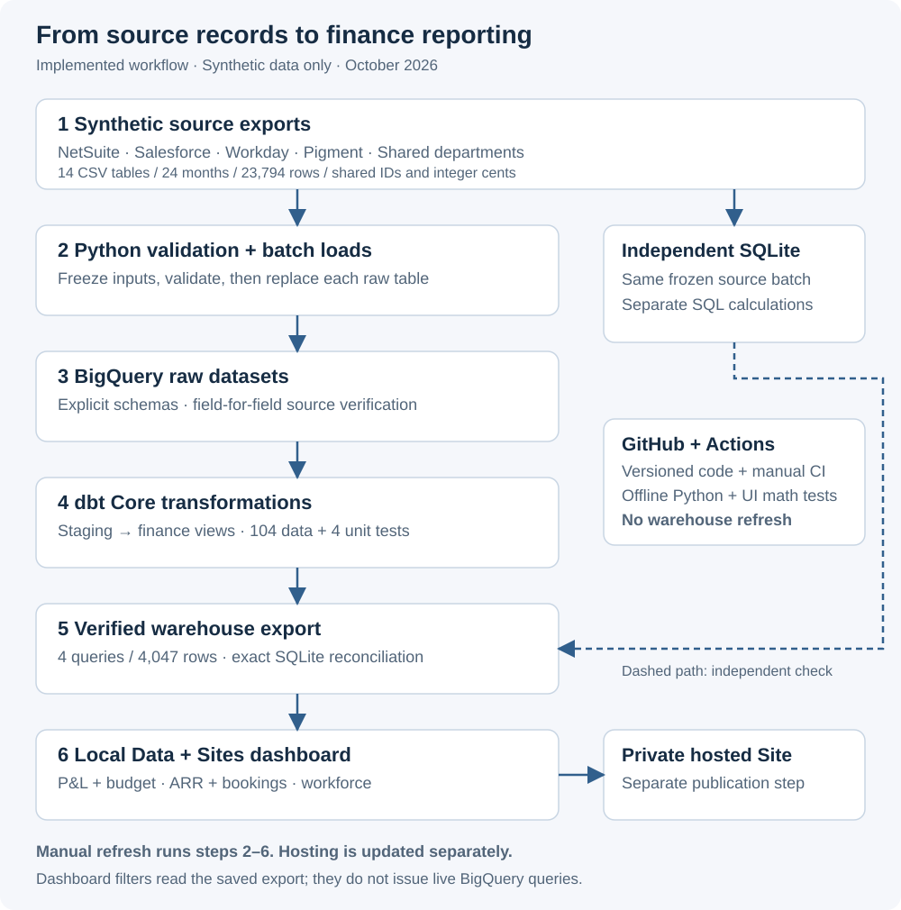
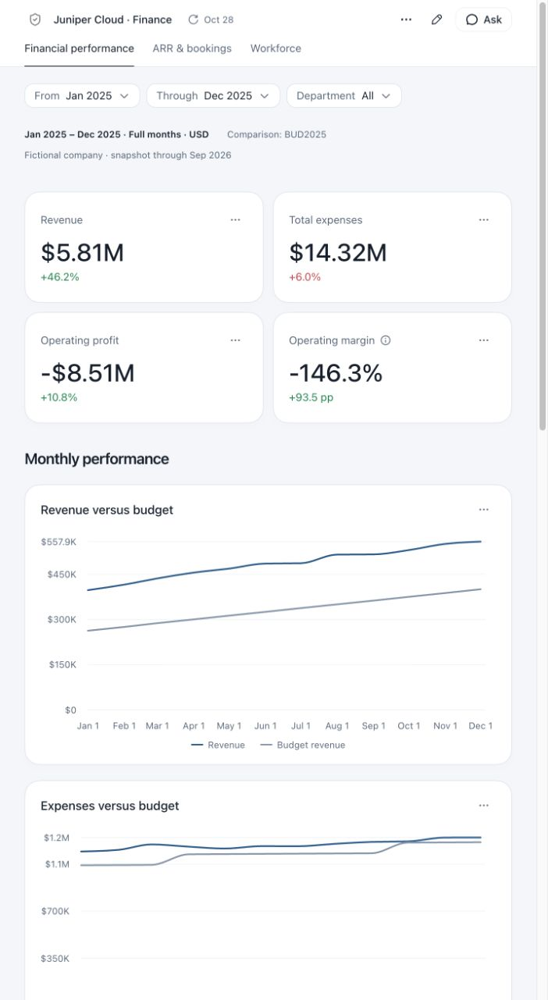
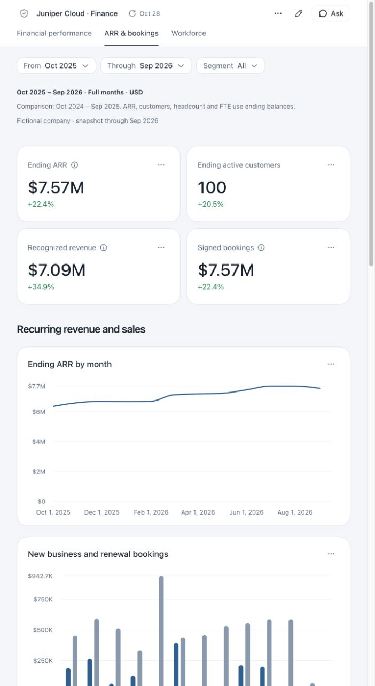
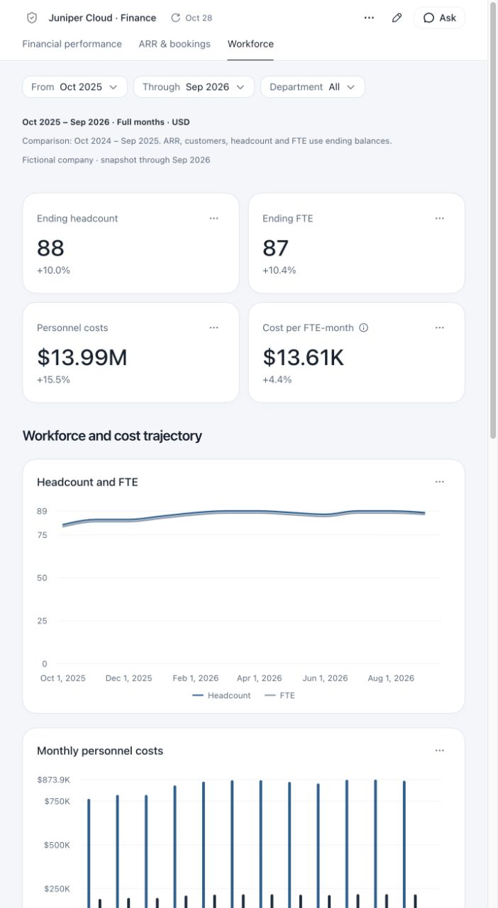

# From SaaS finance data to a reconciled dashboard

**Jack Perry · Finance systems learning project · October 2026**
Python · SQL · SQLite · BigQuery · dbt Core · GitHub Actions · Data + Sites

I built an end-to-end learning prototype that connects familiar FP&A reporting to the data engineering behind it. Synthetic accounting, sales, workforce and planning data flows through a warehouse, tested SQL models and an interactive dashboard.

**Result:** 14 related source tables, 24 months of data and three reporting views, with a complete manual refresh verified from source files through the dashboard export.

> All companies, employees, customers and financial amounts are fictional. This is an AI-assisted personal learning project, not a production implementation or a claim of business savings. I brought the FP&A context, selected the reporting goals and worked through the exercises; Codex assisted with implementation, troubleshooting, testing and documentation.

[Architecture](#how-the-platform-connects) · [Screenshots](#what-the-dashboard-shows) · [Validation](#how-i-checked-the-results) · [Code tour](#explore-the-code) · [Limitations](#scope-and-tradeoffs)

## The finance problem

Accounting, CRM, HR and planning systems describe the same business at different levels of detail. A finance team needs consistent departments, customers, dates and definitions before it can reliably compare actuals with budget or connect revenue, bookings and headcount.

This project models that problem using exports resembling NetSuite, Salesforce, Workday and Pigment. It answers three practical questions:

- How are revenue, expenses and operating profit tracking against the selected budget?
- How do recurring revenue, customer counts and signed bookings change over time?
- How do headcount, FTE and personnel expenses differ across departments?

The scenario covers **October 2024–September 2026**. Its 23,794 source rows include 16,648 GL lines, customer contracts, monthly customer and employee records, and financial plans.

## How the platform connects

[Open the full-size architecture diagram](case-study-assets/architecture.svg).

**Python moves and checks the data. BigQuery stores it and executes SQL. dbt manages the SQL models and their dependencies. The dashboard displays a saved, reconciled export.** Clicking dashboard filters does not run a BigQuery query.

The workflow is primarily ELT: extract and load source data, then transform it inside the warehouse. SQLite provides an independent calculation path so that a successful upload alone is not treated as proof of accurate reporting.

## What the dashboard shows

Actual screenshots of the private hosted dashboard, captured October 29, 2026 using its October 28 warehouse export. Click an image to inspect it at full size. These screenshots are public; the interactive dashboard remains private.

### Financial performance

January–December 2025, all departments, compared with **BUD2025**. Revenue is **$5.81M**, expenses are **$14.32M**, and operating profit is **−$8.51M**. These are synthetic scenario results, not achieved business outcomes. The view also includes department spending, account variance contributions and P&L detail below the captured area.

### ARR and bookings

October 2025–September 2026, all segments. Ending ARR is **$7.57M** and ending active customers are **100**. Recognized revenue and signed bookings are period flows; ARR and customer counts use the ending month. This avoids summing monthly balances across a year.

### Workforce and personnel costs

October 2025–September 2026, all departments. Ending headcount is **88** and ending FTE is **87**; personnel costs total **$13.99M** across the period. Headcount counts people, while FTE reflects their working capacity.

## Trace one number: revenue

1. The [Python generator](../src/synthetic/generate.py) creates synthetic GL entries and related source records. Monetary amounts stay in integer cents.
2. The [refresh loader](../src/ingestion/refresh_sources.py) loads the frozen CSV batch into BigQuery and compares uploaded fields with the source files.
3. [The dbt P&L model](../dbt/models/marts/fct_pnl_monthly.sql) joins GL lines to accounts and calculates revenue as credits minus debits. Expenses use the opposite sign. It groups to month × department × account before budget comparison.
4. [The reporting SQL](../sql/dashboard/finance.sql) selects the modeled finance data. [The reconciliation script](../scripts/reconcile_dashboard.py) compares the warehouse result with independent SQLite calculations.
5. [The dashboard model](../dashboard-site/src/content/dashboard/finance-model.js) applies the selected period and department and converts cents for display.

For January–December 2025, the card displays **$5.81M** and the detail table displays **$5,812,406**, rounded to whole dollars. The source inspector exposes the SQL and extraction time, making the displayed number traceable.

## How I checked the results

Recorded validation results from October 28–29, 2026:

| Check | Verified result | Why it matters |
| --- | --- | --- |
| Source validation | 764 controls passed | Checks schemas, relationships and financial consistency |
| General ledger | Debits and credits both $77,741,040.10 | Confirms the generated ledger balances |
| Raw warehouse contents | All 23,794 rows matched frozen inputs field-for-field | Checks more than row counts |
| dbt build | 14 views, 104 data tests and 4 unit tests passed | Checks models, relationships and selected business logic |
| Reporting reconciliation | 4,047 exported rows matched independent SQLite calculations | Checks the data feeding the dashboard |
| Python tests | 73 passed | Exercises validation, loading and failure controls; cloud calls are mocked in CI |
| Dashboard calculations | 186 numerical comparisons, plus coverage and plan assertions | Checks the measures shown in the UI |

The [successful GitHub Actions run](https://github.com/jmperry15-hash/saas-finance-data-platform-codex/actions/runs/40796000119) tested application commit `614edb6` on a fresh runner. It generated synthetic data and ran offline checks without Google credentials. These suites test different layers; their counts are not an accuracy percentage.

One complete live refresh passed in approximately three minutes. Individual GL reloads were also exercised earlier. A second complete live refresh was offered as optional practice and skipped; it is not claimed as completed.

## Engineering decisions and lessons

- **Define the grain before joining.** Monthly account/department actuals and plan versions need compatible keys to avoid multiplying amounts.
- **Keep money in cents.** Integer arithmetic preserves exact reconciliation before formatting dollars for display.
- **Separate balances from flows.** ARR, customers, headcount and FTE use ending values; revenue, bookings and costs sum over periods.
- **Make refreshes inspectable.** Each run preserves source fingerprints, job IDs, test results and a receipt. Full-table replacement avoids appending duplicate batches.
- **Publish only verified reporting data.** Failed reconciliation stops dashboard promotion. A local build failure restores the previous local snapshot and build.
- **Keep the learning environment bounded.** Billing was verified disabled on October 28. Credentials and generated data are excluded from Git; queries have configured scan limits and expiring tables can be recreated by reloading.

## Scope and tradeoffs

- All inputs are synthetic exports. The mock API demonstrates pagination into a local CSV; API-to-BigQuery and real vendor connectors are not implemented.
- Refreshes are manual. GitHub Actions is a manually triggered validation workflow, not a scheduled warehouse refresh. Hosted publication is separate.
- The dashboard uses **Data + Sites**, replacing the original Streamlit plan. Its data is a saved snapshot, not a live warehouse connection.
- Budget comparison selects BUD2025. Forecast switching, headcount-plan comparisons, ARR bridges and GRR/NRR remain future enhancements.
- BigQuery replacement is atomic per table, not across all 14 tables. A failed batch can leave partially refreshed raw data; the receipt supports recovery before reporting resumes.
- Offline recovery tests passed, but destructive live recovery tests were not performed. This project does not claim production availability, enterprise security certification or measured time savings.

## Explore the code

| Area | Start here |
| --- | --- |
| Generate and validate sources | [Generator](../src/synthetic/generate.py) · [Validation](../src/synthetic/validate.py) · [Data dictionary](data_dictionary.md) |
| Run the complete pipeline | [Refresh orchestrator](../scripts/refresh_project.py) · [Manual refresh guide](manual_refresh.md) |
| Understand the SQL | [dbt models](../dbt/models/) · [Dashboard queries](../sql/dashboard/) |
| Inspect test automation | [GitHub Actions workflow](../.github/workflows/validate.yml) · [Fresh-clone validation guide](portfolio_validation.md) |
| Trace a metric yourself | [Final walkthrough](final_walkthrough.md) · [Project status](project_status.md) |

## A short interview explanation

“I used a synthetic SaaS company to learn how finance reporting is built behind the scenes. With AI coding assistance, I connected Python ingestion, BigQuery and dbt to a dashboard for P&L, budget variances, ARR and workforce reporting. The main lesson was making the numbers traceable: defining reporting grain, distinguishing balances from flows, and reconciling the warehouse export to independent calculations. It is a tested learning prototype with manual refreshes, rather than a production system.”
